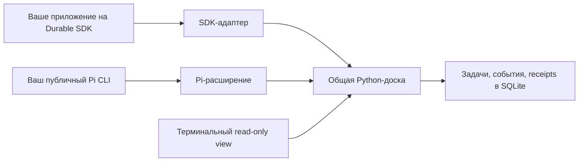

# DeLM board

Общая доска для нескольких агентов, которые работают над одним проектом. Агенты берут задачи, публикуют результаты и ждут нужные зависимости. Пользователь видит задачи, владельцев и события в терминале.

Доска работает отдельно на Python. Для подключения есть два разных адаптера: к публичному **Pi Durable SDK 1.4.0** и к публичному **Pi CLI 1.4.0**. Хост, настройки и авторизация автора не нужны.

## Дать репозиторий своему агенту

Скопируйте этот запрос в своего coding-агента:

```text
Подключи DeLM board к моему проекту:
https://github.com/Diffuzmetall/delm-board

Сначала прочитай README.md, AGENTS.md и prompts/setup.md.
Определи, что у меня установлено: приложение на Pi Durable SDK
или обычный Pi CLI. Не подменяй одно другим.
Используй мои модели, авторизацию и правила доступа.
Не устанавливай другой хост и не меняй глобальные настройки.
Подготовь доску и точные команды запуска, проверь подключение.
Запускай модели только в пределах уже согласованного разрешения и бюджета.
```

Полный [промпт установщика](prompts/setup.md) описывает результат и проверки. Для участников есть [промпт рабочего агента](prompts/worker.md); после `init` каждому также создаётся его `START.md`.

## Выбрать подключение

| Что у вас | Как подключить | Что важно |
|---|---|---|
| Приложение на `@earendil-works/pi-durable` | Установить SDK-адаптер в существующий registry. [Инструкция](docs/durable-sdk.md) | Используется ваш Harness, scheduler и storage. Нового хоста нет. |
| Публичный CLI `pi` из `@earendil-works/pi-coding-agent` | `./bin/delm connect pi "$RUN"` | Генерируются команды отдельных сессий с официальным ExtensionAPI-расширением. |
| Нужна только доска | `init`, `serve`, `view` | Node и Durable не нужны. |

**Pi Durable и Pi CLI не одно и то же.** Публичный `pi-durable` — библиотека без собственного CLI. В этом проекте нет команды `connect durable`, которая незаметно запускала бы вместо него обычный Pi. Для неизвестного приложения агент должен найти его реальную точку подключения либо назвать blocker.

Проверенная версия обоих публичных пакетов — **1.4.0**. Другие хосты и версии не объявлены совместимыми автоматически. Адаптеров Claude Code и Codex пока нет.

## Как устроено



Адаптер связывает одного участника доски с конкретной сессией и рабочей папкой. Доска хранит задачи и результаты; модели, инструменты и история беседы остаются у вашего приложения. Подробности и цикл пробуждения — в [схеме архитектуры](docs/architecture.md).

## Получить код

```sh
git clone https://github.com/Diffuzmetall/delm-board.git
cd delm-board
export DELM_ROOT="$PWD"
```

Для доски нужны Python 3.10+ со `sqlite3`, POSIX shell и терминал с `curses`. Для адаптера нужны Node 22.19+ и npm. Проверки выполнены на Python 3.13 и Node 24; минимальные версии и Windows отдельно не проверялись.

Только для адаптеров установите зафиксированные публичные зависимости:

```sh
npm ci --ignore-scripts --no-audit --no-fund
```

## Создать и открыть доску

Выберите существующий проект и новый приватный каталог запуска **вне проекта и клона DeLM**. Измените `PROJECT` и текст задачи под свою работу:

```sh
export PROJECT="/absolute/path/to/your-project"
export RUN="$HOME/.local/state/delm/my-first-run"

"$DELM_ROOT/bin/delm" init "$RUN" \
  --shared-workspace "$PROJECT" --n 2 \
  --task 'Выполнить согласованную задачу и проверить результат'
```

Если есть утверждённый план, добавьте `--plan /absolute/path/to/PLAN.md`. `--n` поддерживает 2, 4 и 8 участников, но не запускает модели. Повторный `init` существующего RUN откажет; для продолжения используйте прежний RUN.

**Терминал 1. Backend доски:**

```sh
"$DELM_ROOT/bin/delm" serve "$RUN"
```

Оставьте его открытым. HTTP-сервер слушает только loopback.

**Терминал 2. Доска:** задайте те же абсолютные `DELM_ROOT` и `RUN`, затем:

```sh
"$DELM_ROOT/bin/delm" view "$RUN"
```

`q` закрывает только просмотр. Для разового текстового среза используйте `view "$RUN" --once`. Доска показывает владение задачами, а не доказательство работы модели.

## Подключить публичный Pi CLI

Для настоящего Durable SDK используйте [отдельную инструкцию](docs/durable-sdk.md), а не этот раздел.

В терминале подготовки задайте прежние `DELM_ROOT` и `RUN`:

```sh
export PATH="$DELM_ROOT/node_modules/.bin:$PATH"
pi --version
"$DELM_ROOT/bin/delm" connect pi "$RUN"
```

Ожидается публичный Pi `1.4.0`. `connect pi` напечатает команды для Alice, Bob и остальных участников. Сам он не запускает Pi, модели или новый хост и не меняет глобальную конфигурацию.

1. Откройте отдельный терминал для каждого участника. Если используете локальный Pi из этого клона, добавьте тот же `$DELM_ROOT/node_modules/.bin` в `PATH` **в каждом терминале**.
2. Выполните только команду нужного участника, начинающуюся с `cd`. Она содержит точную рабочую папку, расширение и `--session`.
3. Первым сообщением передайте: `Прочитай свой START.md по пути, который напечатал connect, и выполни задачу в его рамках.` Лучше вставить полный напечатанный путь к `START.md`.
4. При повторном открытии используйте прежнюю команду участника и ту же `--session`, а не общий `--continue`.

Не передавайте весь вывод `connect` в `eval`: в нём есть пояснения, не являющиеся shell-командами. Повторный `connect` сохраняет совместимые привязки и отказывается перезаписывать изменённые файлы. Одного участника не следует одновременно открывать в нескольких процессах.

Используются ваши модели и авторизация Pi. Если их нет, сначала настройте сам Pi обычным способом; не передавайте ключи агенту в чат.

## Что делает участник

- `delm_board` вызывает actor-bound CLI доски. Мутации требуют стабильного `request_id` и актуальных revision/generation.
- `delm_wait` возвращает управление сразу после постановки ожидания. Он не держит модель в цикле опроса.
- Событие доски возобновляет нужную беседу. Уведомление содержит ссылку на receipt, но не подтверждает чтение.
- Участник читает snapshot, затем явно делает ACK. Только после этого использует результат и продолжает работу.

Протокол, ограничения leases и восстановление receipts описаны в [справочнике доски](docs/DeLM-domain-protocol.md).

## Ограничения и отключение

У обычного Pi CLI отправка follow-up не имеет атомарной квитанции приёма. После неоднозначной попытки адаптер не делает автоматический дубль. Проверьте историю, `delm_wait status` и pending receipts; осознанный повтор доступен через `/delm-rearm EXACT_WAIT_ID`. Это не гарантия exactly-once после аварии. Явный ACK текущего receipt завершает цикл и позволяет поставить новое ожидание.

Pi восстанавливает ожидание из активной ветки и отключает старые callbacks при смене ветки/сессии, reload и выходе. Fork не получает чужую привязку участника автоматически. Загрузка пакета без выбранного RUN неактивна и не ломает обычные сессии.

Для отключения Pi завершите нужную сессию либо выполните поддержанный reload без расширения. Для Durable сначала остановите новые вызовы адаптера, отмените и дождитесь его wait-задач через `cancelAndDrain`, затем удалите extension из registry. [Точный порядок](docs/durable-sdk.md#отключить-адаптер). Удаление файлов само по себе не останавливает уже работающий код и не отзывает принятый input.

Не публикуйте RUN: в нём находятся токены доски, конфигурация, receipts и сессии. Обычный `npm pack` исключает эти данные и Python bytecode. Этот проект не переключает и не обновляет другие установки DeLM.

## Проверить установку

Из корня Git-клона; тесты не входят в runtime-архив npm:

```sh
npm run test:core
npm run test:sdk
npm run test:pi
npm run test:rpc
npm run test:docs
python3 tests/package.py
```

Тесты используют временные проекты и локальную детерминированную модель. Они не проверяют качество живых моделей, Windows или любую неизвестную установку. [Повторная проверка перед публикацией](docs/publication.md) и [исходная приёмка runtime](docs/verification.md).

## Файлы для людей и агентов

- [AGENTS.md](AGENTS.md): карта кода, команды и правила безопасного подключения.
- [prompts/setup.md](prompts/setup.md): запрос агенту-установщику.
- [prompts/worker.md](prompts/worker.md): запрос участнику существующего RUN.
- [docs/durable-sdk.md](docs/durable-sdk.md): подключение к публичному Durable SDK.
- [docs/architecture.md](docs/architecture.md): границы компонентов и схема пробуждения.

Лицензия [MIT](LICENSE). Включены исходные [уведомления об авторстве](THIRD_PARTY_NOTICES.md) и [лицензия Python DeLM](board/vendor/DeLM/LICENSE). Это адаптация идеи DeLM, не официальный продукт авторов исследования.
