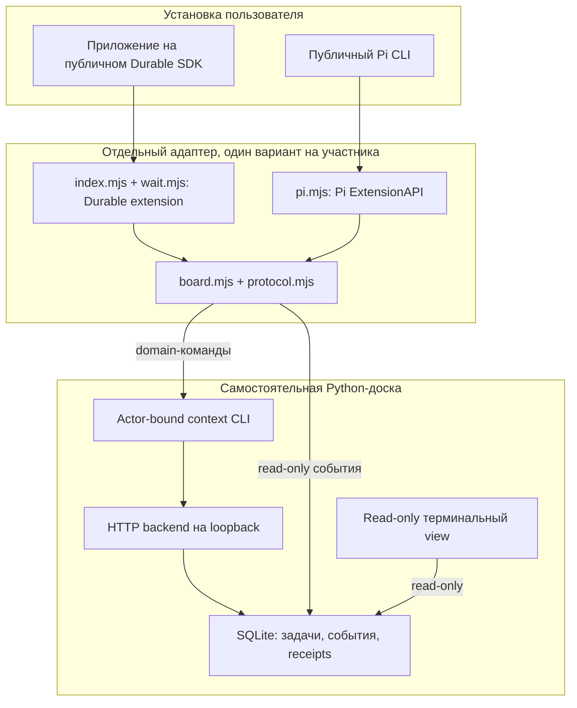
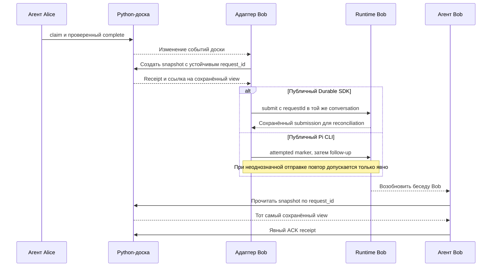

# Доска, адаптер и runtime

DeLM board владеет задачами, событиями и receipts. Приложение участника владеет моделями, авторизацией, инструментами и своей историей. Адаптер связывает их, не создавая новый хост.

## Граница компонентов

`board/` не импортирует адаптер и не открывает storage бесед Pi/Durable. Domain-команды адаптера проходят через собственный CLI и backend доски. Для наблюдения адаптер также читает события **доски** read-only; это не SQL-доступ к сессиям runtime.

Один adapter binding содержит RUN, actor и workspace. Pi дополнительно привязан к точному файлу и ID сессии. SDK-адаптер работает в root conversation 1 существующего Harness, по одной привязке на registry/root. Это не механизм произвольного подключения к уже работающей чужой TUI.

## Цикл результата и пробуждения

Для ясности: в последней части работает Bob в своём runtime. Wake не выполняет работу за него и не делает ACK автоматически. Уведомление о доступной работе не является claim, а публикация FACT сама по себе не завершает задачу.

## Разные гарантии двух точек входа

- **Durable SDK:** `createDurableAdapter` возвращает extension definition. Владелец приложения устанавливает его в свой live registry. Ожидание использует его scheduler/storage, а повторный input сверяется по устойчивому request ID. Дополнительная реальная admission policy сохраняется через `admitInput`.
- **Pi CLI:** расширение использует публичные `registerTool`, `appendEntry`, `sendUserMessage` и lifecycle events. Восстановление учитывает активную ветку и уже записанные send intents. Методы отправки возвращают void, поэтому гарантии Durable admission здесь нет.

Board receipt остаётся pending до явного ACK в обоих вариантах. Хранение receipt не доказывает, что модель его прочитала.

## Отключение

Для Pi отключаются watchers и устаревшие callbacks через штатный lifecycle выбранной сессии. Нельзя считать удаление файла остановкой процесса.

Для SDK владелец приложения сначала прекращает новые arm/input, убирает adapter selection из беседы, вызывает `cancelAndDrain`, затем делает uninstall. Уже принятый input остаётся принятым; чужие задачи, board receipts и история не удаляются. Полный пример приведён в [инструкции SDK](durable-sdk.md).
